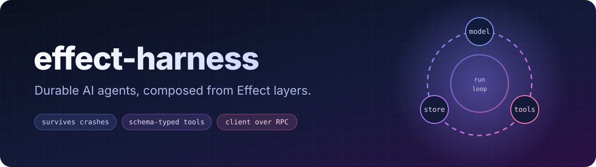
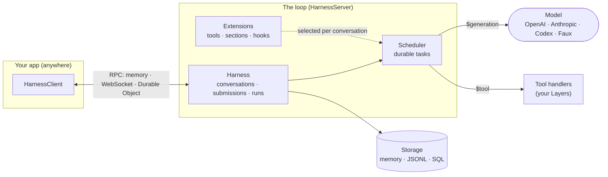

<p align="center">
  
</p>

<p align="center">
  <a href="https://www.npmjs.com/package/effect-harness"></a>
  <a href="https://github.com/julia-script/effect-harness/actions/workflows/ci.yml"></a>
  
  
</p>

<p align="center">
  <b><a href="docs/getting-started.md">Get started</a></b> ·
  <a href="docs/concepts.md">Concepts</a> ·
  <a href="docs/tools.md">Tools</a> ·
  <a href="docs/extensions.md">Extensions</a> ·
  <a href="docs/providers.md">Providers</a> ·
  <a href="docs/deployment.md">Deploy</a> ·
  <a href="docs/reference.md">Reference</a>
</p>

---

**effect-harness** is an agent loop you can kill at any moment. Every conversation, tool call and model response is committed to storage as it happens, so a crash, a deploy or a Cloudflare eviction picks up exactly where it stopped. It is built on [Effect](https://effect.website): tools are Schemas, implementations are Layers, and the client talks to the loop over typed RPC, in the same process or across the internet.

> [!WARNING]
> **effect-harness is still very unstable.** I use it in my own projects and adjust it as I go: fixing bugs, reshaping the API, and sometimes breaking things between minor versions. Pin an exact version, and expect to read the changelog when you upgrade.

<!-- prettier-ignore -->
```ts
const client = yield* HarnessClient.HarnessClient
const root = yield* client.root()

const submission = yield* root.submit({ type: 'input', content: 'Fix the flaky login test' })
const settled = yield* submission.wait // survives restarts: reacquire it by ID later
```

## Why effect-harness?

<table>
<tr>
<td width="33%" valign="top">

### 💾 Durable by default

Runs are durable tasks with checkpoints. Restart the process and unfinished generations, tool calls and compactions resume from storage. Memory, JSONL, SQLite and Postgres backends share one engine.

</td>
<td width="33%" valign="top">

### 🧩 Schemas all the way down

Declare tools with Effect Schemas and implement them as Layers. Arguments are validated, results encoded, failures typed, and a missing implementation is a type error, not a runtime surprise.

</td>
<td width="33%" valign="top">

### 🔌 Client and loop, split

`HarnessClient` speaks RPC to `HarnessServer`. Keep both in one process, put the loop behind a WebSocket, or host it in a Cloudflare Durable Object, and your calling code stays the same.

</td>
</tr>
<tr>
<td valign="top">

### 🤖 Real providers, real accounts

OpenAI, Anthropic, Codex through a ChatGPT sign-in, Claude subscriptions and any OpenAI-compatible server. Let people add accounts at run time, each with its own credentials.

</td>
<td valign="top">

### 🧠 A loop that manages itself

Steering and follow-up queues, automatic retries with backoff, context compaction before the window fills, deferred tool loading with `tool_search`, and per-conversation usage ledgers.

</td>
<td valign="top">

### 🛠️ Batteries included

`read`, `write`, `edit` and `bash` coding tools, a durable code mode that replays QuickJS scripts after a crash, image fitting for vision models, and a scripted `Faux` model for tests.

</td>
</tr>
</table>

## Install

```sh
bun add effect-harness@^0.7.0 effect@4.0.5
```

Add optional peers only for the integrations you use:

| You want                      | Also install                                          |
| ----------------------------- | ----------------------------------------------------- |
| `effect-harness/openai`       | `@effect/ai-openai@4.0.5`                             |
| `effect-harness/anthropic`    | `@effect/ai-anthropic@4.0.5`                          |
| `effect-harness/coding/sharp` | `sharp@0.34.5`                                        |
| `effect-harness/cloudflare`   | `alchemy@2.0.0-beta.83` `@effect/sql-sqlite-do@4.0.5` |

> [!NOTE]
> These docs describe the 0.7 API (lowercase subpaths such as `effect-harness/client`). 0.6 and earlier use a different layout. Until 0.7 is on npm, build from a checkout: `bun install && bun run setup && bun run build`.

## Your first agent in 60 seconds

This runs offline. `Faux` is a scripted model: it asks for the tool, then answers.

```ts
import { Console, Effect, Layer, Schema } from 'effect'
import { HarnessClient, HarnessTransport } from 'effect-harness/client'
import { Extension, HarnessServer } from 'effect-harness/harness'
import { Faux, Model } from 'effect-harness/model'
import { Storage } from 'effect-harness/storage'
import { Tool, Toolkit } from 'effect-harness/tool'

// 1. Declare a tool: a name, a description, and Schemas. No code yet.
const Uppercase = Tool.make('uppercase', {
  description: 'Convert text to uppercase.',
  parameters: Schema.Struct({ text: Schema.String }),
  success: Schema.String,
})
const toolkit = Toolkit.make(Uppercase)

// 2. Implement it, as a Layer, where the loop runs.
const ToolsLive = toolkit.toLayer({
  uppercase: ({ text }) => Effect.succeed(text.toUpperCase()),
})

const program = Effect.gen(function* () {
  // 3. A scripted model: call the tool, then answer. Swap in a real provider later.
  const faux = yield* Faux.make()
  yield* faux.setResponses([
    Faux.message(Faux.toolCall('uppercase', { text: 'hello' }), { stopReason: 'toolUse' }),
    Faux.message('It says HELLO.'),
  ])

  // 4. The loop: extensions, settings, storage and a model.
  const ServerLive = HarnessServer.layer({
    extensions: [Extension.make('text', { toolkit })],
    settings: { model: faux.ref() },
  }).pipe(Layer.provide([ToolsLive, Model.layer([faux.provider]), Storage.layerMemory]))

  // 5. Loop and client share one in-memory transport.
  const AppLive = Layer.merge(ServerLive, HarnessClient.layer).pipe(
    Layer.provide(HarnessTransport.layerMemory),
  )

  yield* Effect.gen(function* () {
    const client = yield* HarnessClient.HarnessClient
    const root = yield* client.root()
    const submission = yield* root.submit({ type: 'input', content: 'Shout "hello" for me.' })
    const settled = yield* submission.wait
    yield* Console.log(`status: ${settled.status}`)

    const { items } = yield* root.entries({ order: 'ascending' }, 50)
    for (const entry of items) yield* Console.log(entry.kind)
  }).pipe(Effect.provide(AppLive))
})

Effect.runPromise(Effect.scoped(program))
```

```text
status: done
$user
$system
$assistant
$tool-result
$assistant
```

That transcript is the whole story: your message, the system prompt, the model asking for `uppercase`, the tool's result, and the final answer. [Getting started](docs/getting-started.md) walks through it line by line and then swaps in a real model and a database.

## How it fits together



A **tool declaration** holds Schemas only, so the client can import it. `Toolkit.toLayer` supplies the implementation where the loop runs. An **extension** bundles tools with system-prompt sections and hooks, and each conversation picks which extensions it uses. `HarnessServer.layer` builds the loop and serves it; `HarnessClient.layer` is what your code calls. Read [Concepts](docs/concepts.md) for the full picture.

## Documentation

| Guide                                         | What you'll learn                                                                    |
| --------------------------------------------- | ------------------------------------------------------------------------------------ |
| 🚀 [Getting started](docs/getting-started.md) | Run a conversation, then switch to a real model and persistent storage.              |
| 🧭 [Concepts](docs/concepts.md)               | Conversations, submissions, runs, entries, documents and tasks, and how they relate. |
| 💬 [Conversations](docs/conversations.md)     | Submitting, steering, forking, resetting, compacting and watching live events.       |
| 🛠️ [Tools](docs/tools.md)                     | Declaring tools, config, replay safety, rich results, nested calls, stock tools.     |
| 🧩 [Extensions](docs/extensions.md)           | System-prompt sections, hooks, wrappers and per-conversation selection.              |
| 🤖 [Providers & accounts](docs/providers.md)  | OpenAI, Anthropic, Codex and Claude sign-in, credentials and run-time accounts.      |
| 💾 [Persistence](docs/persistence.md)         | Storage backends, recovery, your own durable documents and named inits.              |
| 🌍 [Deployment](docs/deployment.md)           | WebSocket servers, browsers, and Cloudflare Durable Objects.                         |
| 📚 [Reference](docs/reference.md)             | Every subpath, settings and their defaults, built-in kinds.                          |

## Examples

- **[Cloudflare](examples/cloudflare/README.md)**: one harness per Durable Object, with accounts added at run time and a command-line chat client over WebSockets.

## Develop

```sh
bun install --frozen-lockfile
bun run setup        # patch the local compiler and linter for Effect diagnostics
bun run build
bun run check        # format, lint, typecheck
bun run test
bun run test:package # pack, install into an isolated consumer, run under Node 24+
```

Tests live next to the code, in each module's `test/` folder, with fixtures several modules share in `src/test/`. Every PR carries a changeset (`bun run changeset`); see [Releasing](docs/releasing.md) for the publishing workflow.

## Credits

The harness architecture is nearly all [Pi Durable](https://github.com/earendil-works/pi)'s. The durable session and storage model, the task scheduler, conversation turns and recovery, compaction, the coding tools and the provider sign-in flows all follow Pi's design, and many modules are direct ports of it.

My work has mostly been porting it to [Effect](https://effect.website) and making it take advantage of Effect's composability and ecosystem: Schemas for every tool, record and setting; Layers for handlers, storage and providers; typed RPC between client and loop; and Effect's platform, SQL and AI packages underneath.

Source module comments identify the Pi component each one models or ports; code mode uses `@earendil-works/pi-codemode`. The distributed [NOTICE](NOTICE) retains the upstream attribution and MIT license.
