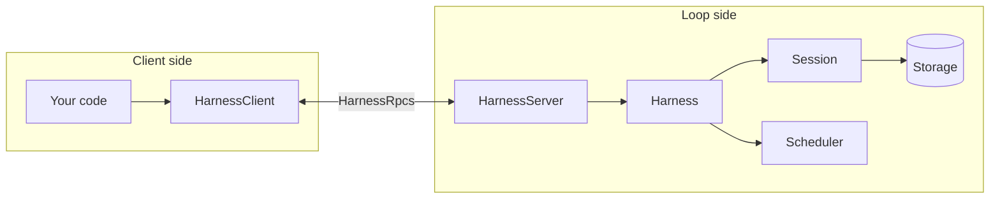
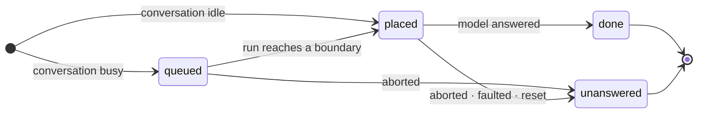
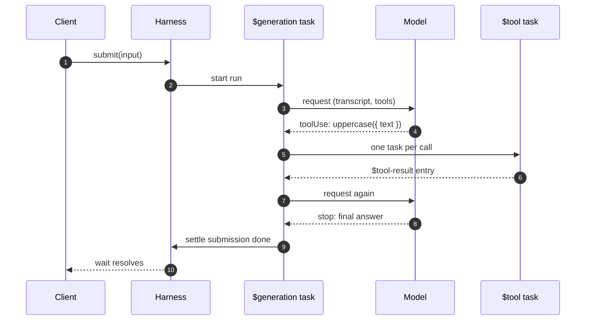

# 🧭 Concepts

effect-harness has a small vocabulary. Once these eight words click, the rest of the API reads naturally.

| Term             | In one line                                                                                      |
| ---------------- | ------------------------------------------------------------------------------------------------ |
| **Loop**         | The process that owns a store and runs the agent: `HarnessServer`, over a `Harness`.             |
| **Client**       | What your code calls: `HarnessClient`, connected to the loop by a transport.                     |
| **Conversation** | An append-only transcript plus its built-in documents. The root one always exists.               |
| **Entry**        | One immutable item of a transcript: `$user`, `$assistant`, `$tool-result`, or your own kind.     |
| **Submission**   | Durably admitted input to one conversation, with a status you can wait on.                       |
| **Run**          | The work one batch of input triggers: generations and tool rounds until the model yields.        |
| **Task**         | A durable state machine with checkpoints. Generations, tool calls and compactions are all tasks. |
| **Document**     | Schema-shaped JSON state stored next to the transcript and changed in the same commit.           |

## Loop and client

The **client** imports nothing the loop runs. It sends `HarnessRpcs` over an `RpcClient.Protocol`: `HarnessTransport.layerMemory` in one process, `layerWebSocket(url)` across a network. That's why tool declarations, extension declarations and `Init` declarations are plain data: the client and the loop can share them.

The **loop** is `Harness.layer`, which `HarnessServer.layer` builds and serves. It owns one **Session** (the single writer of a `Storage`, committing atomically) and one **Scheduler** (which runs durable tasks and resumes them after a restart).

> [!NOTE]
> Code that runs inside the loop, such as a custom task or an `Initializer`, uses the loop-side `Harness` service directly. Everything else should use `HarnessClient`.

## Conversations and entries

A conversation is an append-only list of entries. Every entry has a `kind`; built-in kinds start with `$` and custom ones must not.

| Kind           | Written by                                                  |
| -------------- | ----------------------------------------------------------- |
| `$user`        | An input submission (or your own kind, via `entry.kind`).   |
| `$system`      | The generation, whenever the system prompt or tools change. |
| `$assistant`   | The generation, for each model response.                    |
| `$tool-result` | The tool task, for every tool call, success or not.         |
| `$compaction`  | The compaction task: a summary that replaces older context. |
| `$reset`       | `conversation.reset()`, which starts fresh context.         |

Conversations can **fork** at any visible entry: the child sees the parent's history up to that point and then diverges. Each conversation also has **ownership**: `ownerless`, or owned by a task (as a sub-agent's conversation is).

## Submissions

A submission is how anything enters a conversation. There are two drafts:

- `{ type: 'input', content }`: user input that may start a run.
- `{ type: 'write', entry }`: a passive entry, such as a note from your app, appended without asking the model.

While a run is live, new input waits in the `$inbox` document. `whenBusy` decides how: a **steer** is placed at the next boundary (after the current tool round), a **follow-up** when the model would otherwise stop, and `reject` refuses it. See [Conversations](conversations.md#steering-and-follow-ups).

## Runs and tasks

Input to an idle conversation starts a **run**. A run is driven by tasks, and every task is durable: its whole state is a JSON checkpoint naming its next `phase`.

| Built-in task | What it does                                                                |
| ------------- | --------------------------------------------------------------------------- |
| `$generation` | One model request of a run, its retries, and its tool round.                |
| `$tool`       | One tool call: validate, record intent, run the handler, append the result. |
| `$compaction` | Summarize older context so the next request fits the window.                |

When the process stops, nothing is lost but in-flight work since the last commit. On restart the Scheduler re-runs each live task from its checkpoint. That's where [replay safety](tools.md#replay-safety) matters.

## Documents

Documents are typed JSON values that live next to the transcript and change in the same atomic commits. The harness keeps its own state this way:

| Document | Holds                                                                    |
| -------- | ------------------------------------------------------------------------ |
| `$agent` | The conversation's model, reasoning, extensions, tools and instructions. |
| `$inbox` | Queued submissions waiting for a boundary.                               |
| `$live`  | The current run and its inputs.                                          |
| `$usage` | Tokens and cost spent, per model and per tool.                           |

You can define your own with `Document.make`, scoped to the session, a conversation, or a task, with a choice of what happens on fork. See [Persistence](persistence.md#your-own-documents).

## Agents and extensions

Each request resolves the conversation's **agent** from `$agent` and the harness `Settings`: which model, which extensions, which of their tools the model is offered, and the system prompt, assembled from the extensions' **sections** plus the conversation's own `instructions`.

An **extension** is the unit of reuse: tools, sections, hooks, wrappers and tasks under one name. Install extensions in the loop once; select them per conversation with `conversation.configure({ extensions })`. See [Extensions](extensions.md).
