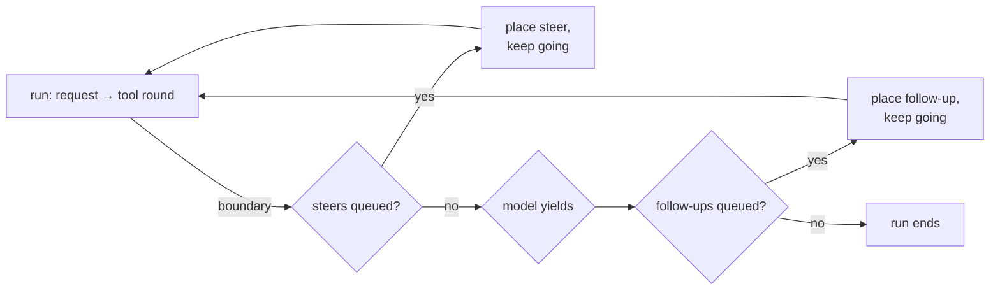

# 💬 Conversations

Everything here goes through `HarnessClient`. Each snippet runs inside `Effect.gen` with the client in context:

<!-- prettier-ignore -->
```ts
const client = yield* HarnessClient.HarnessClient
const root = yield* client.root()
```

- [Submitting input](#submitting-input)
- [Waiting, reacquiring and aborting](#waiting-reacquiring-and-aborting)
- [Steering and follow-ups](#steering-and-follow-ups)
- [Configuring the agent](#configuring-the-agent)
- [Forking](#forking)
- [Resets and compaction](#resets-and-compaction)
- [Reading the transcript](#reading-the-transcript)
- [Watching live](#watching-live)
- [More conversations](#more-conversations)

## Submitting input

<!-- prettier-ignore -->
```ts
const submission = yield* root.submit({
  type: 'input',
  content: 'Find the flaky test',
  requestId: 'job-42', // optional: deduplicates retries of the same request
})
```

`content` is a string or a list of content parts, such as text and images. Three optional fields change how the input is recorded and queued:

| Field       | Default      | Meaning                                                                                                                         |
| ----------- | ------------ | ------------------------------------------------------------------------------------------------------------------------------- |
| `requestId` | none         | Submitting the same ID again returns the existing submission instead of a new one.                                              |
| `whenBusy`  | `'followUp'` | What to do while a run is live: `'steer'`, `'followUp'` or `'reject'`.                                                          |
| `entry`     | `$user`      | Record it as your own kind, such as `{ kind: 'slack.message', data: { author: 'dana' } }`. The model still sees a user message. |

To add something to the transcript without asking the model, submit a **write**:

<!-- prettier-ignore -->
```ts
yield* root.submit({ type: 'write', entry: { kind: 'app.note', data: { text: 'CI is red' } } })
```

## Waiting, reacquiring and aborting

<!-- prettier-ignore -->
```ts
const settled = yield* submission.wait

if (settled.type === 'input' && settled.status === 'done') {
  settled.answer // the EntryId of the final $assistant entry
} else if (settled.status === 'unanswered') {
  settled.reason // 'aborted', 'faulted', 'reset', …
}
```

Interrupting `wait` leaves the submission running. Reacquire it any time, after a restart too:

<!-- prettier-ignore -->
```ts
const again = yield* client.submission(submission.id) // undefined if it doesn't exist
```

| To stop…                     | Call                               |
| ---------------------------- | ---------------------------------- |
| one queued submission        | `submission.abort`                 |
| the conversation's live work | `root.abort()`                     |
| …including background tasks  | `root.abort({ background: true })` |
| a single task                | `client.abortTask(taskId)`         |

`submission.abort` only withdraws input that is still queued; it reports `'already_placed'` or `'settled'` otherwise.

## Steering and follow-ups

A conversation runs one run at a time. Input that arrives while it's busy waits in the `$inbox` and is placed at a **boundary**:



<!-- prettier-ignore -->
```ts
// Course-correct the run that's in progress.
yield* root.submit({ type: 'input', content: 'Only look in auth/', whenBusy: 'steer' })

// Ask once it's done.
yield* root.submit({ type: 'input', content: 'Then write a fix', whenBusy: 'followUp' })
```

Settings decide whether a boundary places queued items `'one-at-a-time'` (the default) or `'all'` at once: `steeringMode` and `followUpMode`.

## Configuring the agent

Each conversation's `$agent` document chooses what its next request asks with. A field you pass replaces the stored one; `null` clears it back to the harness default.

<!-- prettier-ignore -->
```ts
yield* root.configure({
  model: Anthropic.ref('claude-opus-5-5'),
  reasoning: 'high',
  instructions: 'You are a careful reviewer. Never push to main.',
  extensions: { add: ['ops'] }, // or an exact list: ['coding-tools', 'ops']
  tools: { remove: ['bash'] }, // or an exact list, in order
  config: { read: { cwd: '/repo' } }, // per-tool config, over the extension's
})

const agent = yield* root.agent // what the next request resolves to
agent.tools // ['read', 'write', 'edit', 'tool_search']
agent.deferred // enabled tools not offered yet (see tool_search)
agent.sections // ['codemode', 'on-call', 'instructions']
```

## Forking

Fork at any visible entry to explore an alternative. The child inherits history up to that entry; parent and child then run independently, even at the same time.

<!-- prettier-ignore -->
```ts
if (settled.type === 'input' && settled.status === 'done') {
  const fork = yield* root.fork(settled.answer, { ownership: { kind: 'ownerless' } })
  yield* fork.configure({ instructions: 'Try a different approach.' })
  yield* fork.submit({ type: 'input', content: 'What else could it be?' })
}
```

How each document carries over is part of its definition: rewindable documents can copy their state as of the fork entry, others copy the current state or start fresh. `$usage` always starts empty.

## Resets and compaction

Long conversations eventually outgrow the context window. Two tools help:

<!-- prettier-ignore -->
```ts
// Summarize older context now. Returns the compaction task's ID.
yield* root.compact('Keep the decisions, drop the logs')

// Start fresh context, keeping the transcript, with a handoff note for the model.
yield* root.reset('We fixed the test. Next: the release notes.')
```

You rarely need `compact` by hand: by default, a generation compacts first whenever the transcript gets within `reserveTokens` of the window, and starts a background compaction a little earlier. Tune it in [Settings](reference.md#settings).

## Reading the transcript

<!-- prettier-ignore -->
```ts
// Entries, paged.
const page = yield* root.entries({ order: 'ascending' }, 50)
page.items // EntryRecord[]
if (page.next) yield* root.entries({ order: 'ascending' }, 50, page.next)

// Exactly what the model would see next, after compactions and resets.
const context = yield* root.context()
context.messages

// …or as of an earlier entry.
yield* root.context({ at: someEntryId })
```

## Watching live

`root.events` streams the conversation's activity, shaped like a coding agent's session events: a `snapshot`, then one batch per commit. It's what you build a chat UI on.

```ts
const watch = Effect.scoped(
  Effect.gen(function* () {
    const { snapshot, batches } = yield* root.events
    yield* Console.log(`${snapshot.entries.length} entries so far`)

    yield* batches.pipe(
      Stream.flattenIterable,
      Stream.runForEach((event) => {
        switch (event.type) {
          case 'message_update':
            return Effect.forEach(event.changes, (change) =>
              change.type === 'text_delta' ? Console.log(change.delta) : Effect.void,
            )
          case 'tool_execution_start':
            return Console.log(`→ ${event.toolName}`)
          case 'run_end':
            return Console.log('done')
          default:
            return Effect.void
        }
      }),
    )
  }),
)
```

<details>
<summary><b>Every event type</b></summary>

| Event                                              | When                                                                |
| -------------------------------------------------- | ------------------------------------------------------------------- |
| `snapshot`                                         | First, and again if the watcher falls more than 100 batches behind. |
| `run_start` / `run_end`                            | A run begins or ends, with its input submission IDs.                |
| `turn_start` / `turn_end`                          | One generation of the run.                                          |
| `message_start` / `message_update` / `message_end` | The assistant message as it streams.                                |
| `tool_execution_start` / `tool_execution_end`      | A tool call, with its arguments and result entry.                   |
| `inbox_update`                                     | Queued steers and follow-ups changed.                               |
| `submission`                                       | A submission record changed.                                        |
| `auto_retry_start` / `auto_retry_end`              | A retryable model failure is backing off.                           |
| `deferred_poll`                                    | A deferred (batch) response will be polled.                         |
| `entry_appended`                                   | An entry without a model message, such as a write.                  |
| `agent_changed` / `usage_changed`                  | `$agent` or `$usage` changed.                                       |
| `compaction_start` / `compaction_end`              | A compaction, blocking or in the background.                        |
| `task_failed`                                      | A task faulted.                                                     |

</details>

Two lower-level watches are also available: `root.view` (the active transcript plus built-in documents, as `{ value, changes }`) and `client.taskGraph` (every live task in the loop).

## More conversations

The root conversation is one of many. Create others, optionally running a [named init](persistence.md#named-inits) in the same commit:

<!-- prettier-ignore -->
```ts
const ticket = yield* client.createConversation({ ownership: { kind: 'ownerless' } })
const existing = yield* client.conversation(ticket.id) // undefined if unknown

yield* client.waitForIdle // every ownerless conversation is idle
const usage = yield* client.usage // spend across all conversations
const live = yield* client.inspect // live tasks and unsettled submissions
```
