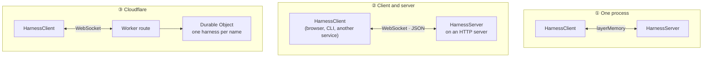

# 🌍 Deployment

The loop and its clients only ever talk through a transport, so the same calling code works in every topology below.



- [One process](#one-process)
- [A WebSocket server](#a-websocket-server)
- [Clients anywhere](#clients-anywhere)
- [Cloudflare Durable Objects](#cloudflare-durable-objects)

## One process

Provide `HarnessTransport.layerMemory` once, to both the server and the client, as in [Getting started](getting-started.md). Values pass between fibers without being encoded.

> [!TIP]
> In tests, use `HarnessTransport.makeMemoryEncoded` instead: every message is encoded and decoded as if it crossed a process, which proves your setup can be split later.

## A WebSocket server

Give the server `layerWebSocketServer(path)` and serve the router on your platform's HTTP server:

```ts
import { BunHttpServer, BunRuntime } from '@effect/platform-bun'
import { Layer } from 'effect'
import { HttpRouter } from 'effect/http'
import { HarnessTransport } from 'effect-harness/client'
import { HarnessServer } from 'effect-harness/harness'

const HarnessLive = HarnessServer.layer({ extensions, settings }).pipe(
  Layer.provide([ToolsLive, ModelLive, StorageLive]),
  Layer.provide(HarnessTransport.layerWebSocketServer('/harness')),
)

HttpRouter.serve(HarnessLive).pipe(
  Layer.provide(BunHttpServer.layer({ port: 3000 })),
  Layer.launch,
  BunRuntime.runMain,
)
```

On Node, use `NodeHttpServer` from `@effect/platform-node`. The same router can serve other RPC groups at other paths, such as `CredentialStore.layerServer` or `Accounts.layerServer`.

## Clients anywhere

```ts
import { HarnessClient, HarnessTransport } from 'effect-harness/client'

const ClientLive = HarnessClient.layer.pipe(
  Layer.provide(HarnessTransport.layerWebSocket('ws://localhost:3000/harness')),
)
```

`layerWebSocket` uses the global `WebSocket`, so it runs in browsers, Bun and Deno, and reconnects after transient failures. Watches such as `conversation.events` resubscribe on their own, as soon as the connection is back, and start again from the loop's state then: the events of the gap arrive in the new snapshot.

`effect-harness/client` imports nothing the loop runs, so it's safe to bundle for the browser. Share your tool declarations, extension declarations and `Init`s with it freely; keep handlers on the server.

## Cloudflare Durable Objects

`effect-harness/cloudflare` runs one harness per Durable Object, deployed with [Alchemy](https://alchemy.run). Name objects after a user or a workspace: each has its own conversations, accounts and credentials in the object's SQLite, and since an object is single-threaded, the loop is always its store's only writer.

```ts
// src/Agent.ts: the Durable Object
export default class Agent extends Cloudflare.RpcDurableObject<Agent>()(
  'Agent',
  { schema: HarnessObject.Rpcs },
  Effect.succeed(
    Effect.succeed(
      HarnessObject.layer({ adapters }).pipe(
        Layer.provide([
          OpenAiCodex.layerAdapter(),
          OpenAi.layerAdapter,
          Anthropic.layerAdapter,
          FetchHttpClient.layer,
        ]),
      ),
    ),
  ),
) {}

// src/Api.ts: the Worker in front, checking a token
export default class Api extends Cloudflare.Worker<Api>()(
  'Api',
  { main: import.meta.url },
  Effect.gen(function* () {
    const agents = yield* Agent
    const token = yield* Config.Redacted('HARNESS_TOKEN')
    return { fetch: HarnessObject.route(agents, { token }) }
  }),
) {}
```

| What you get              | How                                                                                       |
| ------------------------- | ----------------------------------------------------------------------------------------- |
| Same client protocol      | Alchemy serves the RPCs over hibernatable WebSockets; `HarnessClient` connects unchanged. |
| Stays awake while working | `layerKeepAwake` keeps the object alive while any task is live.                           |
| Survives eviction         | The next activation resumes tasks from SQLite, and clients' watches reopen.               |
| Run-time accounts         | `HarnessObject.Rpcs` merges `HarnessRpcs` with `AccountsRpcs`.                            |
| Routing                   | `route` forwards `/agents/<name>` to the object of that name once the token checks out.   |

The [Cloudflare example](../examples/cloudflare/README.md) is a complete, deployable app with a command-line chat client. Run it locally with no Cloudflare account:

```sh
HARNESS_TOKEN=dev-token bun run example:cloudflare
```

> [!NOTE]
> Workers have no file system or processes, so the coding tools and code mode aren't available there.
