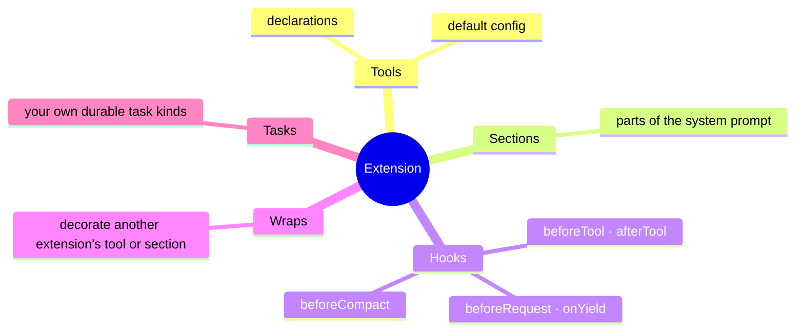

# 🧩 Extensions

An extension is a named bundle of everything that shapes an agent:



You install extensions in the loop once. Each conversation then **selects** the ones it uses, so a support bot and a coding agent can share one server.

- [Making one](#making-one)
- [System-prompt sections](#system-prompt-sections)
- [Hooks](#hooks)
- [Wrapping other extensions](#wrapping-other-extensions)
- [Selecting extensions per conversation](#selecting-extensions-per-conversation)
- [Installing at run time](#installing-at-run-time)

## Making one

```ts
import { Extension, HarnessServer } from 'effect-harness/harness'

const ops = Extension.make('ops', {
  toolkit, // tool declarations
  config: { deploy: { region: 'eu-west-1' } }, // default tool config
  sections: [/* … */],
  hooks: [/* … */],
})

HarnessServer.layer({ extensions: [ops] }).pipe(Layer.provide(DeployLive))
```

An extension holds declarations, not handlers. Installing it reads each tool's implementation from context, where `toolkit.toLayer(handlers)` put it. If two selected extensions declare a tool with the same name, the later one wins.

## System-prompt sections

The system prompt is assembled from the selected extensions' sections, in order, followed by the conversation's own `instructions`.

```ts
Extension.section('on-call', ({ conversationId, agent, read }) =>
  Effect.succeed(`You are on call for ${agent.extensions.join(', ')}.`),
)
```

By default the text is wrapped as `<on-call>…</on-call>`; pass `{ tag: false }` to leave it bare. Return `undefined` to leave the section out.

A section's `render` gets the conversation ID, the resolved agent, the sections the model currently sees, and `read`, which reads committed documents, so a section can render live state from your own [documents](persistence.md#your-own-documents).

> [!TIP]
> Render deterministically. Any change in a section's text appends a `$system` entry and invalidates the provider's prompt cache.

## Hooks

Hooks are typed questions the built-in tasks ask before they commit a decision. Answer them with `Extension.hook(kind, handlers)`:

```ts
import { Generation } from 'effect-harness/harness'
import { ToolTask } from 'effect-harness/tool'

const guardrails = Extension.make('guardrails', {
  hooks: [
    Extension.hook(ToolTask.Hooks, {
      beforeTool: (call) =>
        Effect.succeed(
          call.name === 'deploy' && call.arguments['env'] === 'prod'
            ? { block: 'Production deploys need a human.' }
            : undefined,
        ),
    }),
    Extension.hook(Generation.Hooks, {
      onYield: (answer) =>
        Effect.succeed(
          answer.content.some((block) => block.type === 'text' && block.text.includes('TODO'))
            ? { continue: 'Finish the TODOs before you stop.' }
            : undefined,
        ),
    }),
  ],
})
```

| Hook            | Asked by      | Can                                                            |
| --------------- | ------------- | -------------------------------------------------------------- |
| `beforeRequest` | `$generation` | Replace the messages of one request (not the transcript).      |
| `afterResponse` | `$generation` | Observe every model response.                                  |
| `onYield`       | `$generation` | Keep the run going with more input when the model would stop.  |
| `afterTools`    | `$generation` | Observe a finished tool round and its result entries.          |
| `beforeTool`    | `$tool`       | Rewrite a call's arguments, or block it with an error message. |
| `afterTool`     | `$tool`       | Replace a call's result before it is committed.                |
| `beforeCompact` | `$compaction` | Decline a compaction, or supply the summary text yourself.     |

Every hook also gets an `api` with the task's ID, its conversation, committed document reads and the task's memos.

> [!WARNING]
> Hooks run outside the commit, so a crash before that commit can ask them again. If a hook must decide exactly once, record the decision with `api.memo`.

## Wrapping other extensions

A wrap decorates a tool or section that **another** selected extension provides, without touching its code:

```ts
const shouting = Extension.make('shouting', {
  wraps: [
    Extension.wrapSection('on-call', (section) => ({
      ...section,
      render: (input) => Effect.map(section.render(input), (text) => text?.toUpperCase()),
    })),
    Extension.wrapTool('deploy', (runner) => runner /* time it, log it, rate-limit it… */),
  ],
})
```

## Selecting extensions per conversation

With no selection, a conversation uses every installed extension. Narrow it in `Settings` for everyone, or per conversation:

<!-- prettier-ignore -->
```ts
// Harness-wide default
HarnessServer.layer({
  extensions: [coding, ops, guardrails],
  settings: { extensions: ['coding-tools'] },
})

// This conversation: the default plus two more
yield* conversation.configure({ extensions: { add: ['ops', 'guardrails'] } })

// …or exactly these, in order
yield* conversation.configure({ extensions: ['ops', 'guardrails'] })
```

Then trim the tools themselves with `tools` (which are enabled) and `modelTools` (which are offered to the model, including [deferred](tools.md#deferred-tools-and-tool_search) ones).

## Installing at run time

`Harness.layer` also provides the `Extensions` registry, so the loop can install or uninstall extensions while it runs, such as tools from an MCP server that just connected:

<!-- prettier-ignore -->
```ts
const extensions = yield* Extensions.Extensions
yield* extensions.install(mcpExtension).pipe(Effect.provide(McpToolsLive)) // its handlers
yield* extensions.uninstall('mcp-github')
```

Installing an extension with a name that's already installed replaces it in place. `Extensions.layerInstall(extension)` does the same when a Layer builds.

Tasks declared by an extension are installed for every conversation, whichever ones select it.
