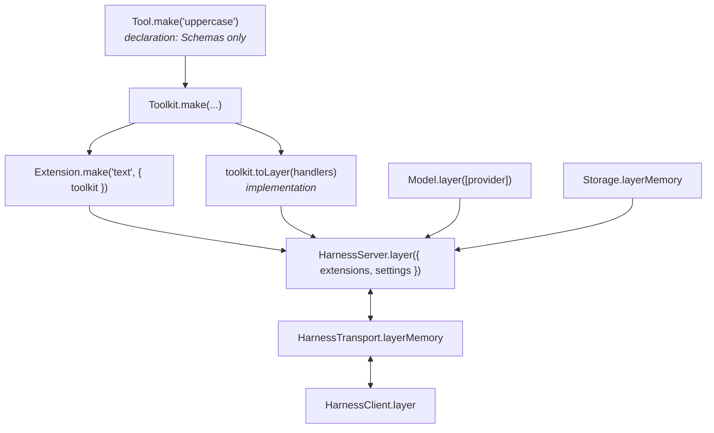

# 🚀 Getting started

By the end of this page you'll have a conversation that calls a tool, talks to a real model, and survives a restart. It takes about ten minutes.

- [1. Install](#1-install)
- [2. Run the offline example](#2-run-the-offline-example)
- [3. What just happened](#3-what-just-happened)
- [4. Talk to a real model](#4-talk-to-a-real-model)
- [5. Keep it on disk](#5-keep-it-on-disk)
- [6. Survive a restart](#6-survive-a-restart)
- [Where next](#where-next)

## 1. Install

```sh
bun add effect-harness@^0.7.0 effect@4.0.5
```

effect-harness runs on Bun and on Node 24+. Provider and platform integrations are optional peers, so install `@effect/ai-anthropic@4.0.5` or `@effect/ai-openai@4.0.5` when you get to step 4.

> [!TIP]
> Working from a checkout instead? Run `bun install && bun run setup && bun run build`, then save the examples at the repository root. Package exports resolve to `dist/`, so rebuild after changing `src/`.

## 2. Run the offline example

Save the [README example](../README.md#your-first-agent-in-60-seconds) as `agent.ts` and run it:

```sh
bun agent.ts
```

```text
status: done
$user
$system
$assistant
$tool-result
$assistant
```

No API key, no network: the `Faux` model is scripted to request the `uppercase` tool and then answer.

## 3. What just happened

There are five moving parts, and every real app has the same five.



| Piece                 | Role                                                                                                                  |
| --------------------- | --------------------------------------------------------------------------------------------------------------------- |
| `Tool.make`           | Names a tool and its parameter, success and failure Schemas. It holds no code, so a browser client can import it too. |
| `toolkit.toLayer`     | The handlers. A Layer, so handlers can depend on any service: a database, an HTTP client, a file system.              |
| `Extension.make`      | Bundles tools (and later, prompt sections and hooks) under a name a conversation can select.                          |
| `HarnessServer.layer` | The loop: a Session over `Storage`, a durable task Scheduler, and the RPC handlers clients call.                      |
| `HarnessClient.layer` | What your code uses. It sends RPCs over whichever transport is in context.                                            |

Then the conversation itself:

1. `client.root()` opens the reserved root conversation, creating it the first time.
2. `root.submit({ type: 'input', … })` durably admits your message. The conversation was idle, so it starts a **run**.
3. The run's `$generation` task asks the model. The model answers with a tool call, so a `$tool` task runs `uppercase` and appends a `$tool-result` entry.
4. The generation asks again, gets a final answer, and settles your submission `done`.
5. `submission.wait` returns that settled record: `{ status: 'done', entry, answer }`, where `answer` is the ID of the final `$assistant` entry.

> [!IMPORTANT]
> A settled submission is not always answered. `status` is `done` or `unanswered`, with a `reason` such as `aborted`. Check it rather than assuming the model replied.

## 4. Talk to a real model

Replace the `Faux` model with a provider. `CredentialStore.layerConfig()` reads API keys from the environment (`ANTHROPIC_API_KEY`, `OPENAI_API_KEY`, …), and providers need an `HttpClient`.

```ts
import { Layer } from 'effect'
import { FetchHttpClient } from 'effect/http'
import { Anthropic } from 'effect-harness/anthropic'
import { CredentialStore } from 'effect-harness/credentials'
import { Model } from 'effect-harness/model'

const ModelLive = Model.layer([Anthropic.provider()]).pipe(
  Layer.provide([CredentialStore.layerConfig(), FetchHttpClient.layer]),
)

const ServerLive = HarnessServer.layer({
  extensions: [Extension.make('text', { toolkit })],
  settings: { model: Anthropic.ref('claude-sonnet-5-5'), reasoning: 'medium' },
}).pipe(Layer.provide([ToolsLive, ModelLive, Storage.layerMemory]))
```

Drop the `faux.setResponses` lines, and the model now decides for itself when to call `uppercase`. [Providers & accounts](providers.md) covers OpenAI, Codex and Claude sign-in, and adding accounts while the app runs.

## 5. Keep it on disk

`Storage.layerMemory` forgets everything on exit. Swap it for a JSONL directory (or SQL, see [Persistence](persistence.md)):

```ts
import { BunServices } from '@effect/platform-bun'

const StorageLive = Storage.layerJsonl('./agent-data').pipe(Layer.provide(BunServices.layer))
```

On Node, provide `NodeServices.layer` from `@effect/platform-node` instead. The argument is a directory, not a file.

## 6. Survive a restart

Give each submission a `requestId`. It is a deduplication key: submitting the same ID to the same conversation again returns the submission that already exists instead of admitting a second one.

<!-- prettier-ignore -->
```ts
const submission = yield* root.submit({
  type: 'input',
  content: 'Fix the flaky login test',
  requestId: 'job-42',
})
const settled = yield* submission.wait
```

Kill the process halfway through and run it again. The loop reopens the store, the scheduler resumes every unfinished task from its last checkpoint, and `submit` with `job-42` hands back the original submission, so `wait` returns its answer. If you kept the submission ID instead, `client.submission(id)` reacquires it.

> [!WARNING]
> A tool call that a crash interrupted mid-flight is **not** run again unless its tool is declared `replay: 'safe'`. Otherwise the model sees an `interrupted` error result and decides what to do. See [replay safety](tools.md#replay-safety).

## Where next

- 🧭 [Concepts](concepts.md): the mental model behind runs, entries and tasks.
- 💬 [Conversations](conversations.md): steering, forking, resets and live events.
- 🛠️ [Tools](tools.md): config, rich results, deferred tools and the stock coding tools.
