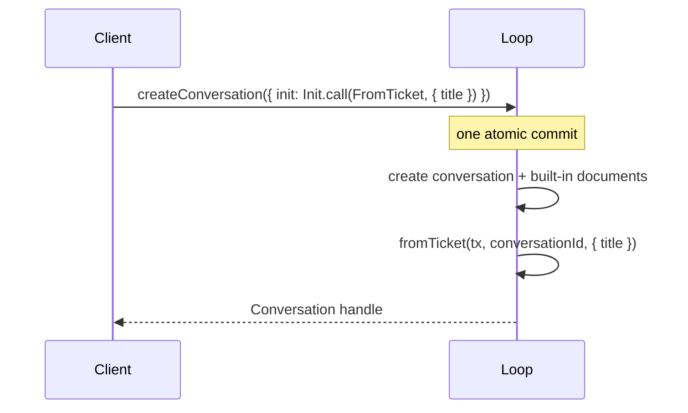

# 💾 Persistence

Everything the loop knows lives in one `Storage`: conversations, entries, submissions, task checkpoints and documents. A **Session** is its only writer, and every change is one atomic commit.

- [Storage backends](#storage-backends)
- [What recovery covers](#what-recovery-covers)
- [Your own documents](#your-own-documents)
- [Named inits](#named-inits)
- [Reserved names](#reserved-names)

## Storage backends

| Layer                           | Needs                                          | Good for                                   |
| ------------------------------- | ---------------------------------------------- | ------------------------------------------ |
| `Storage.layerMemory`           | nothing                                        | tests, demos, browser sandboxes            |
| `Storage.layerJsonl(directory)` | `FileSystem`, `Path`                           | local agents and CLIs                      |
| `Storage.layerSql({ prefix? })` | an Effect SQL `SqlClient` (SQLite or Postgres) | servers, Durable Objects, shared databases |

All three run the same engine, so behavior is identical; only where the bytes land differs.

```ts
import { BunServices } from '@effect/platform-bun'
import { SqliteClient } from '@effect/sql-sqlite-bun'
import { Storage } from 'effect-harness/storage'

// A directory of JSONL files
const JsonlLive = Storage.layerJsonl('./agent-data').pipe(Layer.provide(BunServices.layer))

// SQLite, with prefixed tables so it can share a database
const SqliteLive = Storage.layerSql({ prefix: 'harness_' }).pipe(
  Layer.provide(SqliteClient.layer({ filename: './agent.db' })),
)
```

The SQL store creates and migrates its tables with Effect's `Migrator` and works with `@effect/sql-sqlite-node`, `@effect/sql-sqlite-bun`, `@effect/sql-pg`, `@effect/sql-pglite` and Cloudflare's `@effect/sql-sqlite-do`. Pass `{ fsync: true }` to `layerJsonl` to flush every commit to stable storage before it is published.

> [!CAUTION]
> One loop per store. A Session assumes it is the only writer, so never point two running loops at the same directory or tables.

## What recovery covers

When a loop opens a store that a previous process left mid-run, the Scheduler resumes every live task from its last checkpoint:

| Was running                      | On restart                                                                  |
| -------------------------------- | --------------------------------------------------------------------------- |
| A model request                  | Resumes from the generation's last checkpoint.                              |
| A retry backoff or deferred poll | Waits out the remaining time, then continues.                               |
| A tool call, `replay: 'safe'`    | Runs the handler again.                                                     |
| A tool call, `replay: 'unsafe'`  | Answers `interrupted`; the model sees it and decides what to do.            |
| Code mode                        | Replays the script deterministically from its journal, then continues live. |
| A compaction                     | Resumes from its checkpoint.                                                |

Submissions keep their IDs and request IDs, so clients reacquire them with `client.submission(id)`, or by submitting the same `requestId` again.

Recovery restores what the store holds. It can't restore what your tools changed outside it: if a handler wrote to a file system or an API, that resource needs to be there when the loop comes back.

## Your own documents

Documents are typed JSON values committed alongside the transcript. Define one with a kind, a version, an owner and an initial value:

```ts
import { Document } from 'effect-harness/session'

type Ticket = { title: string; labels: Array<string> }

const TicketDoc = Document.make<Ticket>({
  kind: 'app.ticket',
  version: 1,
  scope: 'conversation',
  history: 'rewindable',
  fork: 'asOf',
  initial: () => Effect.succeed({ title: '', labels: [] }),
})
```

| `scope`          | One per…     | Options                                                                                                                           |
| ---------------- | ------------ | --------------------------------------------------------------------------------------------------------------------------------- |
| `'session'`      | store        | none                                                                                                                              |
| `'conversation'` | conversation | `history: 'latest'` or `'rewindable'` (readable as of any entry); `fork`: `'current'`, `'initial'`, or `'asOf'` (rewindable only) |
| `'task'`         | task         | none; retired with the task                                                                                                       |

Inside a commit, `tx.doc(token, owner)` returns a **draft** you mutate in place; the Session records the change as ops and applies it atomically with whatever else the commit does:

<!-- prettier-ignore -->
```ts
const ticket = yield* tx.doc(TicketDoc, conversationId)
ticket.title = 'Login test is flaky'
ticket.labels.push('triage')
```

Read committed values with `session.snapshot(token, owner)`, or `snapshotAsOf` for rewindable ones, from loop-side code such as a section's `read` or a hook's `api`. `Document.makeFamily` defines keyed documents, one per key, each started from a seed. Bump `version` and supply `migrate` when the shape changes.

## Named inits

Often a new conversation should start with some state: a ticket, a workspace, a persona. A client can't send a callback across a transport, so it names an **init** instead, and the loop runs the matching **initializer** in the same commit that creates the conversation.



<!-- prettier-ignore -->
```ts
import { Init } from 'effect-harness/client'
import { Initializer } from 'effect-harness/harness'
// Shared: the name and the payload Schema.
const FromTicket = Init.make('from-ticket', Schema.Struct({ title: Schema.String }))

// Loop: what it does.
const fromTicket = Initializer.make(FromTicket, (tx, conversationId, { title }) =>
  Effect.gen(function* () {
    const ticket = yield* tx.doc(TicketDoc, conversationId)
    ticket.title = title
  }),
)
HarnessServer.layer({ initializers: [fromTicket] })

// Client: call it.
yield* client.createConversation({
  ownership: { kind: 'ownerless' },
  init: Init.call(FromTicket, { title: 'Login test is flaky' }),
})
```

`client.root({ init })` and `conversation.fork(at, { ownership, init })` take one too. If the initializer fails, nothing is created and the call fails with `InitFailed`. To run something for **every** new conversation, pass `conversationCreated` to `HarnessServer.layer` instead.

## Reserved names

Built-in kinds and keys start with `$`: entries such as `$user` and `$assistant`, documents such as `$agent` and `$usage`, tasks such as `$generation` and `$tool`, and the `$tool-output` result type. Custom input-entry kinds can't start with `$`; prefix yours with your app's name instead, such as `app.note`.
