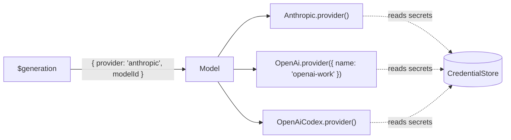

# 🤖 Providers & accounts

The loop asks a `Model` service for every generation. A `Model` routes each request to a **provider** by the name in its model ref, so one loop can talk to several providers and several accounts of the same one at once.



- [Built-in providers](#built-in-providers)
- [Choosing a model](#choosing-a-model)
- [Credentials](#credentials)
- [Subscription sign-in](#subscription-sign-in)
- [Accounts added at run time](#accounts-added-at-run-time)
- [Bring your own model](#bring-your-own-model)
- [Testing with `Faux`](#testing-with-faux)

## Built-in providers

| Import                                           | Provider               | Default name      | Authenticates with                    |
| ------------------------------------------------ | ---------------------- | ----------------- | ------------------------------------- |
| `OpenAi` from `effect-harness/openai`            | OpenAI Responses API   | `openai`          | API key                               |
| `OpenAiCodex` from `effect-harness/openai`       | Codex via ChatGPT      | `openai-codex`    | Device-code sign-in, refreshed tokens |
| `Anthropic` from `effect-harness/anthropic`      | Anthropic Messages API | `anthropic`       | API key                               |
| `AnthropicOAuth` from `effect-harness/anthropic` | Claude subscription    | `anthropic-oauth` | Browser sign-in, refreshed tokens     |
| `Faux` from `effect-harness/model`               | Scripted, for tests    | `faux`            | Nothing                               |

Each provider is a plain value; `Model.layer` turns a list of them into the service. Providers need an `HttpClient`, and `CredentialStore` unless you hand them a fixed key:

```ts
import { FetchHttpClient } from 'effect/http'
import { Anthropic } from 'effect-harness/anthropic'
import { CredentialStore } from 'effect-harness/credentials'
import { Model } from 'effect-harness/model'
import { OpenAi } from 'effect-harness/openai'

const ModelLive = Model.layer([Anthropic.provider(), OpenAi.provider()]).pipe(
  Layer.provide([CredentialStore.layerConfig(), FetchHttpClient.layer]),
)
```

Any OpenAI-compatible server works through `OpenAi.provider({ apiUrl })`, OpenRouter included:

```ts
OpenAi.provider({ name: 'openrouter', apiUrl: 'https://openrouter.ai/api/v1' })
```

## Choosing a model

A model ref is `{ provider, modelId }`. Each provider has a `ref` helper:

<!-- prettier-ignore -->
```ts
HarnessServer.layer({
  settings: { model: Anthropic.ref('claude-sonnet-5-5'), reasoning: 'medium' },
})

// Per conversation:
yield* conversation.configure({ model: OpenAi.ref('gpt-5', 'openai-work'), reasoning: 'high' })
```

A conversation with no model of its own uses the one in `Settings`. With neither, its run ends `unanswered` with reason `no_model`.

Providers ship a catalog of models with their context windows, costs and reasoning support, which is what compaction and `$usage` use. Pass `models` to serve others, and use `listModels` to see what an account can reach right now:

<!-- prettier-ignore -->
```ts
const listed = yield* Anthropic.provider().listModels
```

## Credentials

`CredentialStore.CredentialStore` is the service where secrets live. The `CredentialStore` module provides its storage layers. Pick a store by where your app runs:

| Layer                                  | Stores                                                               | Writable |
| -------------------------------------- | -------------------------------------------------------------------- | :------: |
| `CredentialStore.layerConfig()`        | Reads `ANTHROPIC_API_KEY`, `OPENAI_API_KEY`, … from `Config`         |    ❌    |
| `CredentialStore.layerMemory()`        | In memory, for tests and single-process tools                        |    ✅    |
| `CredentialStore.layerKeyValueStore()` | JSON in any `KeyValueStore`, such as a private directory             |    ✅    |
| `BunCredentials.layer()`               | The OS keychain via `Bun.secrets` (`effect-harness/credentials/bun`) |    ✅    |
| `CredentialStore.layerRpc`             | A store served elsewhere with `CredentialStore.layerServer`          |    ✅    |

Providers look up a credential under their **name**, so `OpenAi.provider({ name: 'openai-work' })` reads the key stored as `openai-work`. Subscription tokens refresh near expiry and are written back with compare-and-set, so they need a writable store.

## Subscription sign-in

**Codex** uses a device code: show the person a URL and a code, and the login completes when they approve it.

<!-- prettier-ignore -->
```ts
yield* OpenAiCodex.login({
  onCode: ({ url, code }) => Console.log(`Open ${url} and enter ${code}`),
})
// Then serve it:
Model.layer([OpenAiCodex.provider()])
```

**Claude** subscriptions use a browser sign-in with a code to paste back: `AnthropicOAuth.login({ onAuthorize, completion })`, or `begin` and `complete` when the two halves happen in different requests.

Native sign-ins store an optional `Credential.Identity` (`issuer`, `subject`, optional `email` and `name`) and a fresh `revision`. Identity comes from provider account metadata, never from a random credential ID or a user label. Codex uses its ChatGPT account ID; Claude retains `account.uuid` and `account.email_address` when the token response supplies them. Missing identity stays missing. The revision identifies a sign-in generation, not a person: it changes on reauthentication even if the tokens repeat. Refresh preserves both fields and rejects a known account mismatch. Older credentials without these fields remain readable.

## Accounts added at run time

For apps where _people_ connect their own providers, declare **adapters** (the provider types you support) and let the `Accounts` registry manage their **accounts**. Each account becomes a provider named after it, and `Accounts.layerModel` routes to whichever are ready, live.

```ts
import { Accounts, Adapter } from 'effect-harness/accounts'

// Declarations only: a client can import this to draw an "add account" form.
const adapters = Adapter.group(
  OpenAiCodex.adapter,
  AnthropicOAuth.adapter,
  OpenAi.adapter,
  Anthropic.adapter,
)

// Where the loop runs: an implementation per adapter, and somewhere to keep accounts.
const AccountsLive = Accounts.layer(adapters).pipe(
  Layer.provide([
    OpenAiCodex.layerAdapter(),
    AnthropicOAuth.layerAdapter(),
    OpenAi.layerAdapter,
    Anthropic.layerAdapter,
  ]),
  Layer.provideMerge(CredentialStore.layerKeyValueStore()),
  Layer.provide(KeyValueStore.layerFileSystem('./data/accounts')),
  Layer.provide([FetchHttpClient.layer, BunServices.layer]),
)

const ServerLive = HarnessServer.layer().pipe(
  Layer.provide(Accounts.layerModel),
  Layer.provideMerge(AccountsLive),
  // …Storage, transport, HttpClient
)
```

Then add, sign in, and list:

<!-- prettier-ignore -->
```ts
const accounts = yield* Accounts.Accounts

yield* accounts.add({
  adapter: 'openai',
  name: 'openrouter',
  label: 'OpenRouter',
  settings: { apiUrl: 'https://openrouter.ai/api/v1' },
  apiKey: Redacted.make(key), // checked by listing models before the account is saved
})

yield* accounts
  .signIn({ name: 'codex', adapter: 'openai-codex', label: 'ChatGPT' })
  .pipe(
    Stream.runForEach((event) => {
      switch (event.type) {
        case 'started':
          return Effect.void // retain event.id to cancel this attempt
        case 'code':
          return Console.log(`Open ${event.url} and enter ${event.code}`)
        case 'authorization':
          return Console.log(`Open ${event.url}`)
        case 'done':
          return Console.log(`${event.account.name} is ${event.account.status}`)
      }
    }),
  )

for (const { account, models } of yield* accounts.models) {
  // account.status: 'ready' | 'needsAuth' | 'error'
}
```

Serve the registry to remote clients with `Accounts.layerServer` and call it with `AccountsRpcs`; the [Cloudflare example](../examples/cloudflare/README.md) does exactly this.

For Claude, use `signIn({ name: 'claude-work', adapter: 'anthropic-oauth', label: 'Work' })`. Each stream starts with `{ type: 'started', id, name }`, then emits a device `code` or browser `authorization` URL, and finishes with `done`. Every event carries the attempt ID. Browser hosts submit the pasted `code#state` or full callback URL with `completeSignIn(id, Redacted.make(completion))`. A host-owned loopback listener can pass its URL as `SignIn.redirectUri`; that URL belongs only to the attempt and is not stored in account settings. The library does not start a callback server.

Use `cancelSignIn(id)` to cancel explicitly. Unsubscribing or interrupting the stream also releases the attempt. Credentials are staged until login succeeds; failed, cancelled, stale, or removed targets cannot commit the staged tokens. A second attempt for the same account fails with `SignInActive`; different accounts can sign in concurrently. Completion is browser-only and single-use; past, duplicate, device-code, or unknown attempts fail with `InvalidSignIn`. Explicit cancellation fails the sign-in stream with `SignInCancelled`. `AccountsRpcs` exposes the same operations as `CompleteSignIn` and `CancelSignIn`.

Account status includes optional `identity` and `revision`, never tokens or arbitrary credential extras. Account names distinguish saved connections; compare the provider's `issuer` and `subject` to establish an identity match, not the display label or revision. Keeping an active default and pinning conversations to an account remain host policy.

Custom OAuth adapters now implement `login(account, flow)` instead of receiving an `onCode` callback directly. Use `flow.onCode`, or `flow.onAuthorize` and `flow.completion` for `Adapter.browserOAuth`; write the completed OAuth credential under `account.name` in the supplied `CredentialStore` service. The service is isolated to that account for the attempt.

The registry serializes its own mutations in one process. It does not turn two independent metadata and credential stores into a cross-process transaction. Hosts sharing storage with a CLI must supply their own coordination; the built-in key-value credential store must not be shared by two processes.

## Bring your own model

Anything that streams `Model.Event`s can be a provider. Implement the `Model.Provider` interface directly, or wrap an effect/ai `LanguageModel`:

```ts
import { LanguageModelProvider } from 'effect-harness/model'

const provider = LanguageModelProvider.make({
  name: 'my-gateway',
  api: 'my-gateway',
  models: [{ id: 'house-model', contextWindow: 200_000, reasoning: true }],
  languageModel: (model, request) => makeLanguageModelFor(model, request), // read credentials here
})
```

The loop owns the tool loop: a provider never runs tools itself. A response that calls tools ends with `toolUse`, and the loop runs the calls as durable tasks.

Use `Model.layerDynamic(current)` when the set of providers changes while the loop runs; that's what `Accounts.layerModel` is built on.

## Testing with `Faux`

`Faux` streams scripted responses, estimates usage, and records every request it gets, which makes it ideal for testing your tools and hooks without a network:

<!-- prettier-ignore -->
```ts
const faux = yield* Faux.make()
yield* faux.setResponses([
  Faux.message(Faux.toolCall('deploy', { service: 'api', env: 'staging' }), {
    stopReason: 'toolUse',
  }),
  Faux.message('Deployed.'),
])

// …run a conversation…

const requests = yield* faux.requests // what the model was sent
```

A step can also be a `ModelError` (to test retries) or a function of the request.
