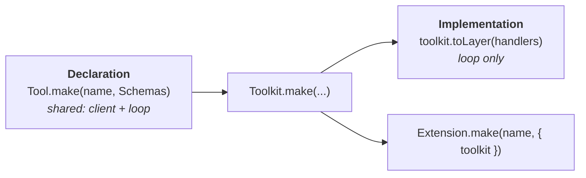
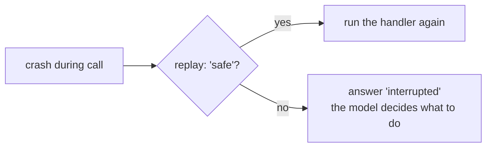

# 🛠️ Tools

A tool has two halves that live in different places:



The declaration is data: Schemas, a description, and how the loop should treat the tool. The implementation is a Layer, so it can depend on anything else in your app.

- [Declaring a tool](#declaring-a-tool)
- [Implementing it](#implementing-it)
- [Config](#config)
- [Replay safety](#replay-safety)
- [What the model sees](#what-the-model-sees)
- [Deferred tools and `tool_search`](#deferred-tools-and-tool_search)
- [Calling tools from tools](#calling-tools-from-tools)
- [Stock tools](#stock-tools)

## Declaring a tool

```ts
import { Schema } from 'effect'
import { Tool, Toolkit } from 'effect-harness/tool'

const Deploy = Tool.make('deploy', {
  description: 'Deploy a service to an environment.',
  parameters: Schema.Struct({
    service: Schema.String,
    env: Schema.Literals(['staging', 'prod']),
  }),
  success: Schema.String,
  failure: Schema.Struct({ reason: Schema.String }),
})

const toolkit = Toolkit.make(Deploy)
```

| Option         | Default                    | What it does                                                                                  |
| -------------- | -------------------------- | --------------------------------------------------------------------------------------------- |
| `description`  | required                   | What the model reads to decide when to call it.                                               |
| `parameters`   | required                   | Arguments Schema; sent to the model as JSON Schema and validated on every call.               |
| `success`      | `Schema.Void`              | What the handler returns.                                                                     |
| `failure`      | `Schema.Never`             | A typed failure. The model sees it as an error result.                                        |
| `config`       | `{}`                       | Settings set by whoever installs the tool, never by the model. [More](#config)                |
| `replay`       | `'unsafe'`                 | Whether an interrupted call may run again after a crash. [More](#replay-safety)               |
| `outputLimits` | 50 KB · 2,000 lines · head | How much of the result the model sees, and whether to keep the start or the end.              |
| `deferred`     | `false`                    | Hide it from the model until a conversation loads it. [More](#deferred-tools-and-tool_search) |
| `callers`      | `['model', 'tools']`       | Who may call it: the model, other tools' handlers, or both.                                   |

## Implementing it

`toolkit.toLayer` takes one handler per tool. Each handler gets the decoded arguments and a context with the call's ID and the tool's decoded config, and returns the success value or fails with the declared failure:

```ts
const DeployLive = toolkit.toLayer({
  deploy: ({ service, env }) =>
    env === 'prod'
      ? Effect.fail({ reason: 'Production deploys go through the release train.' })
      : Effect.succeed(`${service} is live on ${env}`),
})
```

Handlers need services? Build them in an Effect. The Layer then requires whatever that Effect does:

```ts
const DeployLive = toolkit.toLayer(
  Effect.gen(function* () {
    const ci = yield* CiClient
    return {
      deploy: ({ service, env }) => ci.trigger(service, env),
    }
  }),
)
```

> [!TIP]
> A missing implementation is a compile error: `HarnessServer.layer({ extensions })` requires one `Toolkit.Implementation` per tool name of every extension you pass.

Anything other than success or the declared failure is not a result. A defect, or a value that won't encode, ends the call as `tool_error`. Either way, the model always receives a `$tool-result`:

| Result code         | Why                                                                    |
| ------------------- | ---------------------------------------------------------------------- |
| `tool_unavailable`  | No tool of that name is enabled, or it has no implementation.          |
| `invalid_arguments` | The model's arguments don't decode.                                    |
| `invalid_config`    | The tool's config doesn't decode.                                      |
| `blocked`           | A `beforeTool` hook blocked it. See [Extensions](extensions.md#hooks). |
| `tool_error`        | The handler died, or returned something its Schema can't encode.       |
| `interrupted`       | A crash stopped an unsafe call after it started.                       |
| `aborted`           | The conversation or task was aborted.                                  |

## Config

Config is the tool's own settings, such as a working directory or a region. Whoever installs the tool sets it, and each conversation can override it; the model never can.

<!-- prettier-ignore -->
```ts
const Deploy = Tool.make('deploy', {
  // …
  config: Schema.Struct({ region: Schema.optionalKey(Schema.String) }),
})

const DeployLive = toolkit.toLayer({
  deploy: ({ service }, { config }) => deployTo(service, config.region ?? 'us-east-1'),
})

// Set by the extension…
const ops = Extension.make('ops', { toolkit, config: { deploy: { region: 'eu-west-1' } } })

// …and overridden per conversation.
yield* conversation.configure({ config: { deploy: { region: 'ap-south-1' } } })
```

## Replay safety

When the process dies during a tool call, the loop can't know how far the handler got. So on restart, it decides by the tool's `replay` policy:



Use `replay: 'safe'` only when running the whole handler twice is harmless: reads, idempotent writes, or work keyed by `callId`. Anything that sends an email, charges a card or increments a counter should stay `'unsafe'`, the default.

## What the model sees

A plain `success` value is shown as text, or as JSON. To return images, attach remarks, or hand structured details to your UI, use `ToolResult.Output` as the success (or failure) Schema:

```ts
import { ToolResult } from 'effect-harness/tool'

const Screenshot = Tool.make('screenshot', {
  description: 'Capture the screen.',
  parameters: Schema.Struct({}),
  success: ToolResult.Output,
  replay: 'safe',
})

const ScreenshotLive = Toolkit.make(Screenshot).toLayer({
  screenshot: () =>
    Effect.succeed(
      ToolResult.output([{ type: 'image', data: pngBase64, mimeType: 'image/png' }], {
        diagnostics: [{ severity: 'info', message: 'Scaled to 50%' }], // the model sees these
        details: { width: 1280, height: 800 }, // the model doesn't; your UI does
      }),
    ),
})
```

`ToolResult.text(value, options)` is the one-block shortcut. Results longer than `outputLimits` are cut to whole lines, with a diagnostic telling the model it was truncated.

## Deferred tools and `tool_search`

Big toolsets crowd the context. Mark rarely used tools `deferred: true` and install the `tool_search` extension: the model sees only a search tool, and loading a tool adds it to that conversation's offered tools from the next request on.

```ts
import { HarnessServer, ToolSearch } from 'effect-harness/harness'

HarnessServer.layer({ extensions: [ops, ToolSearch.extension] }).pipe(
  Layer.provide([DeployLive, ToolSearch.layer]),
)
```

`conversation.agent` lists not-yet-loaded tools under `deferred`. You can also load them yourself with `configure({ modelTools: { add: ['deploy'] } })`.

## Calling tools from tools

A running handler can call another tool with `Call.execute`. The nested call is its own durable task, keyed within its caller, so after a restart a re-run handler finds the calls it already made instead of making them twice.

```ts
import { Call } from 'effect-harness/tool'

const release = ({ service }) =>
  Effect.gen(function* () {
    const staging = yield* Call.execute(
      'deploy',
      { service, env: 'staging' },
      { key: 'staging' },
    ).pipe(
      Effect.orDie, // refused only when called outside a tool call
    )
    if (staging.isError) return yield* Effect.fail({ reason: 'staging failed' })
    // …
  })
```

Declare a tool with `callers: ['tools']` to make it callable only this way, never by the model.

## Stock tools

### Coding tools: `read`, `write`, `edit`, `bash`

Ported from pi's coding agent and implemented over Effect's `FileSystem`, `Path` and `ChildProcessSpawner`, so whichever implementation you provide decides where files and commands live.

```ts
import { BunServices } from '@effect/platform-bun'
import { CodingHandlers, CodingTools } from 'effect-harness/coding'
import { BunImageProcessor } from 'effect-harness/coding/bun'

HarnessServer.layer({ extensions: [CodingTools.extension] }).pipe(
  Layer.provide([CodingHandlers.layer, BunImageProcessor.layer]),
  Layer.provide(BunServices.layer),
)
```

Each tool's config takes a `cwd`; `bash` also takes a `commandPrefix`. `read` returns images fitted for vision models when an `ImageProcessor` is in context: `BunImageProcessor` (Bun) or `SharpImageProcessor` from `effect-harness/coding/sharp`.

### Code mode

`codemode` lets the model write JavaScript that calls your tools, run in a QuickJS sandbox. It is durable in an unusual way: the VM is deterministic, so after a restart the script is started again from the same seed and fed the results it already got, in order, from a journal. Its tool calls are nested calls that are never run twice.

```ts
import { Codemode, CodemodeHandlers } from 'effect-harness/codemode'

HarnessServer.layer({ extensions: [Codemode.extension(), CodingTools.extension] }).pipe(
  Layer.provide([
    CodemodeHandlers.layer().pipe(Layer.provide(CodemodeHandlers.layerSandbox())),
    CodingHandlers.layer,
  ]),
  Layer.provide(BunServices.layer),
)
```

> [!NOTE]
> Coding tools and code mode need a file system and processes, so they don't run in a Cloudflare Worker.
